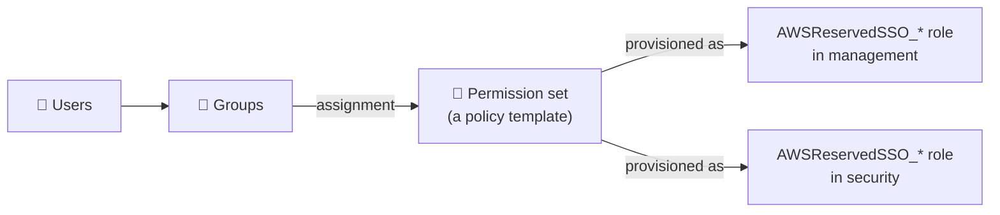

# Phase 2 — Identity Center: One Login to Rule Them All

> **Mission:** everyone signs in once, with MFA, and gets short-lived roles in exactly the accounts they need. No IAM users. (Control **C1**)

[⬅ Phase 1](01-organization.md) · [Lab overview](../README.md) · [Phase 3 ➡](03-root-lockdown.md)

---

## Why this matters

IAM users have **long-lived** passwords and access keys, and those leak. IAM Identity Center (the successor to AWS SSO) gives people a **single portal**. Behind the scenes it creates a role in each account and hands out **temporary** credentials (1–12 hours). Remove someone from a group and their access disappears from every account at once.

## How it fits together



A **permission set** is a template. When you assign *group + permission set + account*, Identity Center creates a role called `AWSReservedSSO_<PermissionSet>_<hash>` in that account. The role trusts a SAML provider named `AWSSSO_…_DO_NOT_DELETE`.

## The access design

| Group | Permission set | Accounts | Session |
|---|---|---|---|
| `Platform-Admins` | `AdministratorAccess` | management, security | 1h |
| `Security-Team` | `SecurityAudit` (SecurityAudit + ReadOnlyAccess) | management, security | 8h |
| `Security-Team` | `AdministratorAccess` | security | 1h |
| `Finance` | `Billing` (job function policy) | management | 4h |
| `Payments-Devs` | *(none yet)* | — | — |

`Payments-Devs` is assigned nothing **on purpose**. Signing in as its user `payments-dev1` shows an empty portal, which is least privilege you can see.

---

## Steps

Do these in the **management account**, with the region set to **N. Virginia (us-east-1)**. Identity Center lives in one region only, and moving it later means starting over.

### Part A: Turn it on
1. Search **IAM Identity Center** → **Enable** → in the box *Enable IAM Identity Center with AWS Organizations*, click **Enable**. Don't pick "account instance".
2. On the **Dashboard**, copy the **AWS access portal URL** (`https://d-xxxxxxxxxx.awsapps.com/start`). You'll need it in Parts F and G.

### Part B: Require MFA (C1)
Settings → **Authentication** tab → *Multi-factor authentication* → **Configure**:
- Prompt users for MFA: ◉ **Every time they sign in (always-on)**
- If a user has no MFA device: ◉ **Require them to register an MFA device at sign in**

→ **Save changes**.

### Part C: Groups
Groups → **Create group**, 4 times: `Platform-Admins`, `Security-Team`, `Finance`, `Payments-Devs`. Don't add users yet.

### Part D: Users
Users → **Add user**. For the password, choose ◉ *Send an email to this user with password setup instructions*.

| Username | Email | Group |
|---|---|---|
| `admin` (or your name) | `you@example.com` | Platform-Admins |
| `payments-dev1` | `you+pdev1@example.com` | Payments-Devs |

Each user gets an invitation email. Don't open them until Part G.

### Part E: Permission sets
Permission sets → **Create permission set**:

| Name | Type | Policies | Session |
|---|---|---|---|
| `AdministratorAccess` | Predefined | AdministratorAccess | **1 hour** |
| `Billing` | Predefined | Billing | 4 hours |
| `SecurityAudit` | **Custom** (it needs two policies) | AWS managed: `SecurityAudit` **and** `ReadOnlyAccess` | 8 hours |

> **Can't find `ReadOnlyAccess`?** Searching for it lists dozens of policies (`AmazonS3ReadOnlyAccess`, `AWSBillingReadOnlyAccess`…). You want the one named **just** `ReadOnlyAccess`, which is often on page 2 or 3. Ticks are kept when you search again, so check the counter shows **2 selected**. Don't pick `ViewOnlyAccess`, which is a different policy.

### Part F: Assignments
Every assignment follows the same pattern:
> *AWS accounts* → tick the account(s) → **Assign users or groups** → *Groups* tab → tick the group → **Next** → tick the permission set → **Next** → **Submit**

| Tick these accounts | Group | Permission set |
|---|---|---|
| management **and** security | Platform-Admins | AdministratorAccess |
| management **and** security | Security-Team | SecurityAudit |
| security only | Security-Team | AdministratorAccess |
| management only | Finance | Billing |

Assign **nothing** to `Payments-Devs`. That's on purpose.

### Part G: Sign in as your SSO user
1. Open a **private/incognito window**, so your current console session doesn't get in the way.
2. Accept your user's invitation email → set a password → **register MFA** (authenticator app).
3. The portal shows **both accounts**. Click *security* → *AdministratorAccess*. You're now in the security account on a temporary role.
4. In another private window, do the same for `payments-dev1`. The portal shows **no accounts**: least privilege, working.

### Set up CLI access through SSO

The CLI reads its settings from a text file **on your computer**: `~/.aws/config` (on a Mac that's `/Users/<you>/.aws/config`). Open it in your local terminal with `nano ~/.aws/config`, or with any text editor, and add the block below at the bottom. Replace the `d-xxxxxxxxxx` URL and the two account IDs:

```ini
[sso-session acme]
sso_start_url = https://d-xxxxxxxxxx.awsapps.com/start
sso_region = us-east-1
sso_registration_scopes = sso:account:access

[profile acme-mgmt]
sso_session = acme
sso_account_id = <MGMT_ID>
sso_role_name = AdministratorAccess
region = us-east-1

[profile acme-security]
sso_session = acme
sso_account_id = <SECURITY_ID>
sso_role_name = AdministratorAccess
region = us-east-1
```
In nano: paste with ⌘V / Ctrl+Shift+V, save with **Ctrl+O** then **Enter**, and exit with **Ctrl+X**.

Then log in. A browser opens: sign in as your **SSO user** (not the IAM user), enter the MFA code, and click **Allow access**.
```bash
aws sso login --sso-session acme
# → "Successfully logged into Start URL: https://d-…awsapps.com/start"
```
From now on, add `--profile acme-mgmt` or `--profile acme-security` to every command.

### Clean up the bootstrap user
SSO now replaces it. IAM → Users → `bootstrap-admin` → **Delete**. Your management account now has **no IAM users**.

## Verify

```bash
aws sts get-caller-identity --profile acme-mgmt
aws sts get-caller-identity --profile acme-security
# both ARNs contain assumed-role/AWSReservedSSO_AdministratorAccess_<hash>/<your-user>
# the hash differs per account: each assignment is a real IAM role in that account

INST=$(aws sso-admin list-instances --profile acme-mgmt --query 'Instances[0].InstanceArn' --output text)
IDS=$(aws sso-admin list-instances --profile acme-mgmt --query 'Instances[0].IdentityStoreId' --output text)
aws sso-admin list-permission-sets --instance-arn $INST --profile acme-mgmt          # 3 ARNs
aws identitystore list-groups --identity-store-id $IDS --profile acme-mgmt --query 'Groups[].DisplayName'   # 4 groups
```
In the console, also check Permission sets → `SecurityAudit` → *Permissions*: both managed policies are listed.

---

## 🔥 Field notes

> [!NOTE]
> **MFA settings have no read API.** You can't check C1 from the CLI. Check it in the console: Settings → Authentication.

> [!WARNING]
> **"The config profile (acme-mgmt) could not be found."** The command ran in **CloudShell**, whose prompt is `~ $`. CloudShell is a separate machine and never sees the `~/.aws/config` on your laptop. Run lab commands in your **local terminal**.

> [!NOTE]
> **"Token has expired and refresh failed."** Admin sessions last 1 hour, on purpose. Run `aws sso login --sso-session acme` again.

> [!TIP]
> **An extra, unused permission set** (e.g. `Security-Team-Permission-Set`) is left over from a first attempt. It's harmless, but delete it so the design table stays the truth.

> [!TIP]
> **One SSO session, many profiles.** Profiles that share an `sso_session` reuse a single login. That's why `acme-security` worked right after you logged in to a different profile in the same session.

---

## 🎤 Interview corner

<details><summary>What actually happens when someone clicks an account in the access portal?</summary>

Identity Center issues a SAML assertion. STS `AssumeRoleWithSAML` trades it for temporary credentials for the `AWSReservedSSO_*` role in that account. CloudTrail records the session with the user's identity attached.
</details>

<details><summary>How do you remove one person's access everywhere, immediately?</summary>

Remove them from their groups, or disable the user. New sessions are refused at once. Existing sessions end at their session duration, which is why admin sessions are kept short (1h).
</details>

<details><summary>Permission set vs IAM role?</summary>

A permission set is a template defined once in Identity Center. Identity Center provisions it as an IAM role in every account it's assigned to, and updates all of those roles when you change the template.
</details>

---

**Terraform:** [`terraform/identity-center/`](../terraform/identity-center). Assignments to accounts that don't exist yet are skipped automatically. The organization instance and the MFA setting must be done in the console; there's no API for them.

[⬅ Phase 1](01-organization.md) · [Lab overview](../README.md) · [Phase 3 ➡](03-root-lockdown.md)
