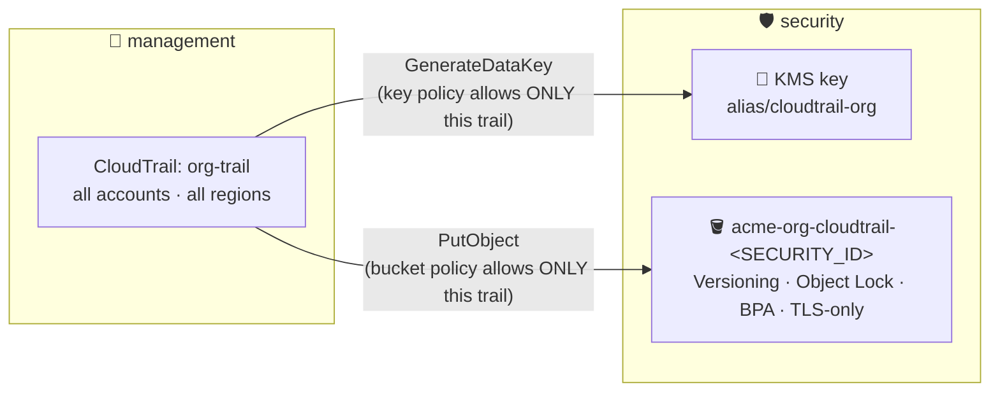

# Phase 4 — Logging: Evidence Nobody Can Erase

> **Mission:** every API call in every account lands in one encrypted bucket in the security account, and you can **prove** no log was deleted or altered. (Control **C11**)

[⬅ Phase 3](03-root-lockdown.md) · [Lab overview](../README.md) · [Phase 5 ➡](05-guardrails.md)

---

## Why this matters

When something goes wrong (a deleted database, a leaked key), the first question is *"who did what, when?"*. CloudTrail answers it, but only if attackers can't delete the logs first. So the logs go to a **different account** than the one being watched, encrypted, and locked.



Member accounts can **see** the org trail, but they can't stop, edit or delete it.

## Concepts in 30 seconds

- **Organization trail:** one trail created in management that logs **every** account. New accounts are included automatically.
- **Cross-account KMS:** the key lives in `security`, but the trail runs in `management`. The **key policy** must explicitly name CloudTrail, scoped with `aws:SourceArn` to *your* trail. That condition is **confused-deputy protection**: without it, someone else's trail could use your key or bucket.
- **Object Lock:** WORM storage (write once, read many) for object *versions*. **Governance** mode can be bypassed by principals with `s3:BypassGovernanceRetention`. **Compliance** mode can't be bypassed by anyone, root included.
- **Log file validation:** each hour CloudTrail writes a signed **digest file** containing the hash of every log file. `validate-logs` recomputes them and shows anything missing or modified.

> [!NOTE]
> **Cost:** the KMS key is ~$1/month. Everything else is about $0 if you leave data events, Insights and CloudWatch Logs **off**.

---

## Steps

**Build in this order:** the key and the bucket in **security** first (1 and 2), then the trail in **management** (3). The trail can't be created until the key and the bucket let it in.

**Before you start, fill in the placeholders** in both policy files, from the lab folder:
```bash
sed -e 's/<MGMT_ID>/<your mgmt id>/g' -e 's/<SECURITY_ID>/<your security id>/g' -e 's/<ORG_ID>/<your o-… id>/g' \
  policies/logging/kms-key-policy.json > /tmp/kms-key-policy.json
sed -e 's/<MGMT_ID>/<your mgmt id>/g' -e 's/<SECURITY_ID>/<your security id>/g' -e 's/<ORG_ID>/<your o-… id>/g' \
  policies/logging/log-bucket-policy.json > /tmp/log-bucket-policy.json
grep -c '<' /tmp/kms-key-policy.json /tmp/log-bucket-policy.json   # want 0 and 0: no placeholders left
```

**To get into the security account:** access portal → **security** → *AdministratorAccess*. Check that the **top-right corner shows the security account ID** and the region is **us-east-1**.

### 1 · KMS key (in `security`, us-east-1)
1. KMS → *Customer managed keys* → **Create key** → Symmetric, Encrypt and decrypt, default advanced options → **Next**.
2. Alias `cloudtrail-org` → **Next** → no key administrators → **Next** → no key users → **Next** → **Finish**.
3. Open the key → **Key policy** tab → **Edit** (click *Switch to policy view* first if you see it).
4. Delete everything in the box, paste the contents of `/tmp/kms-key-policy.json`, and click **Save changes**.
5. Copy the key **ARN** from *General configuration*. Steps 2 and 3 need it.

| Statement | What it says |
|---|---|
| `EnableSecurityAccountAdmin` | The security account manages the key (without this, nobody could) |
| `AllowCloudTrailEncrypt` | CloudTrail may encrypt, but only for **our** trail (`aws:SourceArn`) |
| `AllowCloudTrailDescribeKey` | CloudTrail may check the key exists |
| `AllowOrgPrincipalsToDecryptLogs` | Anyone **in our org** may decrypt CloudTrail logs |

### 2 · S3 bucket (in `security`, us-east-1)

| Setting | Value | Why |
|---|---|---|
| Name | `acme-org-cloudtrail-<SECURITY_ID>` | The account ID keeps it globally unique |
| Object ownership | Bucket owner enforced | No ACL surprises |
| Block all public access | On | C4 |
| Versioning | Enabled | Required for Object Lock |
| Default encryption | SSE-KMS (your key) + **Bucket Key** | The Bucket Key cuts KMS request costs |
| Object Lock | Enabled → default retention **Governance, 1 day** | Short, so the lab can be cleaned up. Production uses Compliance with a retention period of years. |
| Lifecycle | Expire after 30 days; noncurrent versions after 1 day | Keeps storage near $0 |
| Bucket policy | [`policies/logging/log-bucket-policy.json`](../policies/logging/log-bucket-policy.json) | Only our trail may write; TLS only |

Where each setting lives in the console:
- **When you create the bucket:** name, Object Ownership (*ACLs disabled*), Block all public access, Versioning, Default encryption (*SSE-KMS* → choose `cloudtrail-org` → Bucket Key *Enable*), and *Advanced settings* → **Object Lock: Enable**. You can only turn Object Lock on at creation time.
- **After it's created:**
  - *Properties* → Object Lock → **Edit** → default retention Governance, 1 day
  - *Management* → **Create lifecycle rule** → apply to all objects → expire current versions after 30 days, permanently delete noncurrent versions after 1 day
  - *Permissions* → Bucket policy → **Edit** → paste `/tmp/log-bucket-policy.json`

### 3 · Organization trail (in `management`, us-east-1)
Switch to the **management** account in the access portal. CloudTrail → **Create trail**:
- Name: `org-trail` (it must be exactly this, because both policies name it)
- ✅ **Enable for all accounts in my organization**
- Storage: ◉ *Use existing S3 bucket*. **Type** the bucket name; *Browse* can't see buckets in another account.
- Log file SSE-KMS encryption: ✅ → *Existing* key → paste the key ARN
- ✅ Log file validation
- ❌ CloudWatch Logs
- Next page: **Management events** only (Read + Write). ❌ data events, ❌ Insights.

## Verify

```bash
aws cloudtrail get-trail-status --name org-trail --query '{Logging:IsLogging,LastDelivery:LatestDeliveryTime,Error:LatestDeliveryError}'
# After ~1 hour (digests are hourly):
aws cloudtrail validate-logs --trail-arn arn:aws:cloudtrail:us-east-1:<MGMT_ID>:trail/org-trail \
  --start-time 2026-01-01T00:00:00Z --account-id <SECURITY_ID>
```
Logs arrive under `AWSLogs/<ORG_ID>/<ACCOUNT_ID>/CloudTrail/<region>/YYYY/MM/DD/`.

---

## 🔥 Field notes

> [!WARNING]
> **`MalformedPolicyDocumentException: The new key policy will not allow you to update the key policy in the future.`** KMS refuses any policy that would lock the person saving it out of the key. Ours hands control to `arn:aws:iam::<SECURITY_ID>:root`, so the check fails when the key was created in the **management** account by mistake. Check the account ID in the top-right corner. If it's wrong, schedule the stray key for deletion (7 days; a key pending deletion costs nothing), switch to **security**, and create the key again.

> [!NOTE]
> **"Can't fetch current bucket access policy… not updated."** When creating the trail, the console tries to add its permissions to the bucket policy. It can't read a bucket in **another account**. That's harmless, because you wrote the policy yourself.

> [!CAUTION]
> **The deletion that wasn't blocked.** We tested immutability by deleting a log file in the console:
>
> 1. **A plain delete "succeeded."** With versioning, a delete only adds a **delete marker** on top. The real version underneath was intact and still locked.
> 2. **Deleting the *version* also succeeded, permanently.** The S3 console **automatically sends the bypass-governance header** for anyone with `s3:BypassGovernanceRetention`, and `AdministratorAccess` includes it. Governance mode isn't protection against admins.
> 3. **CloudTrail recorded nothing.** S3 object deletes are **data events**, and we had turned those off to save cost.
> 4. **`validate-logs` caught both files:**
>    ```
>    77/77 digest files valid
>    1538/1540 log files valid, 2/1540 log files INVALID
>      …T1325Z_vL5CNJpLi7uF5L08.json.gz   INVALID: not found   ← permanently deleted version
>      …T1325Z_mTmaTjkDgXfzYSec.json.gz   INVALID: not found   ← hidden by delete marker
>    ```
>
> **The fix became control C15:** an SCP denying `s3:BypassGovernanceRetention` (plus retention, versioning, lifecycle and policy changes) on the log bucket for everyone except the break-glass role. See [Phase 5](05-guardrails.md).

> [!TIP]
> **Restore a "deleted" object** by deleting its **delete marker**: Show versions → select the marker row → Delete.

---

## 🎤 Interview corner

<details><summary>Is a versioned S3 bucket immutable?</summary>

No. Deletes add delete markers, lifecycle rules can expire versions, and anyone with `s3:DeleteObjectVersion` can destroy them. Real immutability needs Object Lock in **Compliance** mode, or Governance mode plus an SCP or bucket policy denying the bypass. Pair it with log file validation to *prove* integrity.
</details>

<details><summary>Why does the bucket policy use <code>aws:SourceArn</code>?</summary>

To prevent the confused-deputy problem. CloudTrail is a shared service. Without the condition, *any* AWS customer's trail could write into your bucket or use your key. Scoping to your trail's ARN means only your trail can.
</details>

<details><summary>Why put logs in a separate account?</summary>

Separation of duties. An attacker who compromises a workload account, or even its admin, can't reach the security account's bucket, and SCPs stop member accounts from touching the trail.
</details>

---

**Terraform:** [`terraform/logging/`](../terraform/logging) uses two providers: management for the trail, and `aws.security` for the key and bucket through `OrganizationAccountAccessRole`. Its generated policies were compared statement by statement with the console-built ones: **identical**.

[⬅ Phase 3](03-root-lockdown.md) · [Lab overview](../README.md) · [Phase 5 ➡](05-guardrails.md)
