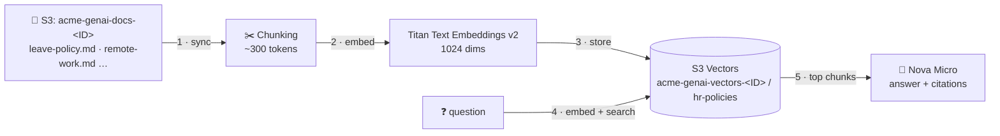

# Phase 3 — Knowledge Base: Teach It the Handbook

> **Mission:** turn AcmeCorp's HR policy documents into a searchable **vector index** that Bedrock can use to answer questions, with sources. (RAG)

[⬅ Phase 2](02-private-endpoints.md) · [Lab overview](../README.md) · [Phase 4 ➡](04-guardrail.md)

> [!NOTE]
> 🔨 **Being built.** Steps were written ahead of the build and are being checked in the console; 🔥 field notes record what differed.

---

## Why this matters

A model knows nothing about AcmeCorp. Fine-tuning is slow and expensive, and goes stale when a policy changes. **RAG** (retrieval-augmented generation) is the usual answer: find the relevant paragraphs first, then give them to the model with the question. A Bedrock **Knowledge Base** does the whole pipeline for you.



## Concepts in 30 seconds

- **Embedding:** a list of numbers (here 1024) that captures meaning. Texts with similar meaning have nearby vectors.
- **Chunking:** documents are split into pieces before embedding. Too big = vague matches; too small = missing context.
- **Vector store:** a database that finds the nearest vectors fast. **S3 Vectors** is S3-priced storage for vectors: no cluster, pay per GB and per query.
- **Sync (ingestion job):** reads the S3 data source, chunks, embeds and writes vectors. Re-run it whenever documents change.
- **`RetrieveAndGenerate`:** one API call that searches the index and asks the model to answer *only* from the retrieved chunks, returning **citations**.

> [!NOTE]
> **Cost:** cents. Embedding the sample docs is a few thousand tokens ($0.02 per 1M). S3 Vectors storage for this size is ≈ $0.

---

## Steps

### 1 · Documents bucket
S3 → **Create bucket**:

| Setting | Value |
|---|---|
| Bucket type | General purpose |
| Name | `acme-genai-docs-<ACCOUNT_ID>` (e.g. `acme-genai-docs-123456789012`) |
| Object Ownership | ACLs disabled (Bucket owner enforced) |
| Block all public access | ✅ on |
| Versioning | **Enable** |
| Encryption | SSE-S3 |

Then:
1. Bucket → **Permissions → Bucket policy → Edit** → paste [`policies/s3/docs-bucket.json`](../policies/s3/docs-bucket.json) with your account ID → *Save*. It denies any request that isn't HTTPS (**G9**).
2. **Upload** the four files from [`sample-docs/`](../sample-docs): `leave-policy.md`, `remote-work.md`, `expenses.md`, `hr-contacts.md`.

> The sample docs include fake contact details (phone, email) on purpose. Phase 4 masks them.

### 2 · Knowledge Base

> [!IMPORTANT]
> **Sign in as an IAM user or role, not root.** As root, Bedrock stops with *"Knowledge Base creation with a root user is not supported."* See [Phase 0, step 1](00-prep.md#1--the-account).

Bedrock → **Knowledge Bases** → *Create*. The console asks which kind of Knowledge Base:

| Option | Pick? | Why |
|---|---|---|
| **Managed KB** *(marked "recommended")* | ❌ | AWS chooses the embeddings model and runs the vector store for you. You can't pick Titan or S3 Vectors, you can't see the chunks/index (the point of this phase), and the lab's IAM/endpoint policies weren't verified against it. A good stretch goal to compare later. |
| **Self-managed KB → Unstructured Vector Store KB** | ✅ | The classic "Knowledge Base with vector store": you choose data source, chunking, embeddings model and vector store. Older consoles call it exactly that. |
| **Self-managed KB → Structured Data Store KB** | ❌ | For SQL questions over Amazon Redshift tables. Our data is text documents. |

Then go through the wizard:

| Step | Setting | Value |
|---|---|---|
| 1 · Details | Name | `acme-hr-kb` |
| | IAM permissions | **Create and use a new service role** |
| | Data source type | **Amazon S3** |
| 2 · Data source | S3 URI | *Browse S3* → `acme-genai-docs-<ACCOUNT_ID>` |
| | Parsing strategy | Default parser |
| | Chunking strategy | **Default chunking** |
| 3 · Data storage and processing | Embeddings model | **Titan Text Embeddings V2**, 1024 dimensions, Floating-point |
| | Vector store creation method | **Quick create a new vector store** |
| | Vector store type | **Amazon S3 Vectors** |
| 4 · Review | | *Create Knowledge Base* (takes 1–3 minutes) |

> [!WARNING]
> **Don't accept Amazon OpenSearch Serverless** if it's pre-selected. It bills for always-on compute, ≈ **$170+/month** even when idle. If S3 Vectors isn't offered, create the store yourself (below) and choose **Use an existing vector store**.

<details><summary>Fallback: create the S3 vector bucket and index by hand</summary>

1. S3 console → left menu **Vector buckets** → *Create vector bucket* → `acme-genai-vectors-<ACCOUNT_ID>`, encryption SSE-S3.
2. Open it → **Create vector index**:

   | Setting | Value | Why |
   |---|---|---|
   | Name | `hr-policies` | |
   | Dimension | **1024** | Must equal the embeddings model's output size |
   | Distance metric | **Cosine** | Standard for text similarity |
   | Non-filterable metadata keys | `AMAZON_BEDROCK_TEXT`, `AMAZON_BEDROCK_METADATA` | Bedrock stores chunk text in these. As filterable keys they hit the **2 KB filterable-metadata limit** and the sync fails. |

3. Copy the **index ARN**. In the KB wizard step 3 choose **Use an existing vector store → Amazon S3 Vectors** and select the bucket/index (or paste the ARN).
</details>

Copy the **Knowledge Base ID** (overview page) into your notepad: Phase 5 needs it.

### 3 · Sync
Knowledge Base → **Data source** section → select the data source → **Sync**. Wait for *Completed*, then open the sync history: expect **4 scanned, 4 indexed, 0 failed**. A failure here usually means the embeddings quota is 0 ([Phase 0](00-prep.md#3--bedrock-quotas)) or the vector index has filterable metadata keys (fallback above).

> Re-run Sync whenever you add or change a document. The KB doesn't watch the bucket.

### 4 · Test in the console
Knowledge Base → **Test** → model **Nova Micro** → ask:
- *"How many days of parental leave do employees get?"*
- *"Can I work from another country?"*

Click **Show source details** under each answer: the chunks must come from the right file (`leave-policy.md`, `remote-work.md`).

## Verify

```bash
KB=$(aws bedrock-agent list-knowledge-bases --query "knowledgeBaseSummaries[?name=='acme-hr-kb'].knowledgeBaseId" --output text)
aws bedrock-agent get-knowledge-base --knowledge-base-id $KB --query 'knowledgeBase.[status,storageConfiguration.type]'
aws bedrock-agent-runtime retrieve-and-generate \
  --input '{"text":"How many days of parental leave do employees get?"}' \
  --retrieve-and-generate-configuration "{\"type\":\"KNOWLEDGE_BASE\",\"knowledgeBaseConfiguration\":{\"knowledgeBaseId\":\"$KB\",\"modelArn\":\"arn:aws:bedrock:us-east-1::foundation-model/amazon.nova-micro-v1:0\"}}" \
  --query '[output.text, citations[0].retrievedReferences[0].location.s3Location.uri]'
```

---

## ⚠️ Known gotchas

- **The Knowledge Base is not in your VPC.** Ingestion and retrieval run inside Bedrock, which reads the docs bucket with **its service role**, not through your gateway endpoint. Don't add an `aws:SourceVpce` deny to the docs bucket, or the sync breaks.
- **S3 Vectors has metadata size limits.** Very large chunks or lots of custom metadata can fail ingestion. Default chunking stays well inside them.
- **Changing the embeddings model means re-creating the index**: vectors from different models aren't comparable.

## 🔥 Field notes

- **Root user blocked.** *"Knowledge Base creation with a root user is not supported. Please sign-in with an IAM user or IAM role and try again."* It's a hard rule in Bedrock, not a setting. Resources created earlier as root (VPC, endpoints, bucket) keep working: they belong to the account, not the user.
- **The console renamed the KB types.** *"Knowledge Base with vector store"* is now **Self-managed KB → Unstructured Vector Store KB**, next to a new **Managed KB (recommended)** option. The table in step 2 explains which to pick.

---

## 🎤 Interview corner

<details><summary>RAG or fine-tuning?</summary>

RAG when the knowledge changes or must be cited (policies, docs, tickets): update the documents, re-sync, done. Fine-tuning changes the model's **behaviour or style**, is expensive, and can't cite sources. Many real systems use RAG on top of a base model and never fine-tune.
</details>

<details><summary>Why S3 Vectors instead of OpenSearch Serverless here?</summary>

Cost model. OpenSearch Serverless bills for always-on compute units (well over $100/month minimum), which is overkill for a few documents and occasional queries. S3 Vectors is pay-per-use. OpenSearch is the better choice for high query rates, hybrid (keyword + vector) search, and very low latency.
</details>

---

**Terraform:** planned stack `terraform/knowledge-base/`.

[⬅ Phase 2](02-private-endpoints.md) · [Lab overview](../README.md) · [Phase 4 ➡](04-guardrail.md)
