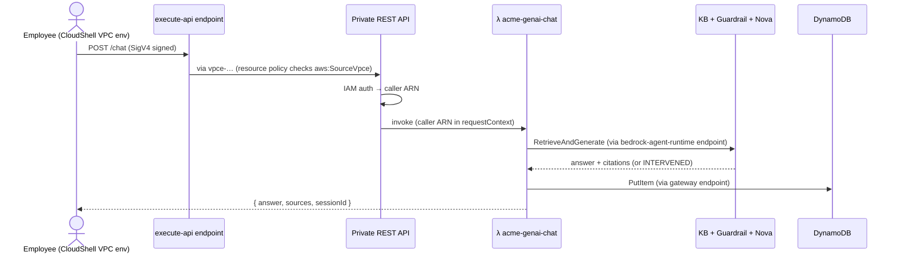

# Phase 5 — API + Lambda: The Assistant Goes Live (Privately)

> **Mission:** a Lambda inside the VPC answers questions through the Knowledge Base and Guardrail, behind a **private** API that only our VPC endpoint can reach, and every caller is identified. (Controls **G2**, **G3**, **G7**, **G8**)

[⬅ Phase 4](04-guardrail.md) · [Lab overview](../README.md) · [Phase 6 ➡](06-audit.md)

> [!NOTE]
> 🔨 **Being built.** Steps were written ahead of the build and are being checked in the console; 🔥 field notes record what differed.

---

## Why this matters

This is where "private" becomes real. The API has **no public URL** that works from the internet, the Lambda has **no route out**, and its role **can't call Bedrock** except through our endpoint. API Gateway uses **IAM auth**, so we always know *who* asked.



## Concepts in 30 seconds

- **Private REST API:** endpoint type *Private*. Reachable only through an `execute-api` interface endpoint, and only if its **resource policy** allows it. (HTTP APIs can't be private; that's why we use REST.)
- **IAM authorization:** the caller signs the request with SigV4; API Gateway checks `execute-api:Invoke` and passes the caller's ARN to Lambda.
- **VPC Lambda:** Lambda creates ENIs in your subnets (needs `AWSLambdaVPCAccessExecutionRole`). Its own logs still reach CloudWatch, because the **Lambda service** ships them, not your code.
- **Sessions:** `RetrieveAndGenerate` returns a `sessionId`. Sending it back keeps the conversation context.

> [!NOTE]
> **Cost:** ≈ $0. Lambda, API Gateway and DynamoDB on-demand are within the free tier at lab volume.

---

## Steps

You need these from your notepad: account ID, KB ID (Phase 3), guardrail ID (Phase 4), and the three `vpce-…` IDs (Phase 2).

### 1 · DynamoDB table
DynamoDB → **Tables → Create table**:

| Setting | Value |
|---|---|
| Table name | `acme-genai-chat-history` |
| Partition key | `sessionId` (String) |
| Sort key | `ts` (String) |
| Table settings | *Customize settings* → Capacity mode **On-demand** |
| Encryption | Owned by Amazon DynamoDB (default) |

### 2 · Lambda role
1. IAM → **Roles → Create role** → Trusted entity *AWS service* → Use case **Lambda** → *Next*.
2. Attach the AWS managed policy **`AWSLambdaVPCAccessExecutionRole`**. It lets Lambda create its network interfaces in your subnets and write its own logs.
3. Name `acme-genai-chat-role` → *Create role*.
4. Open the role → **Add permissions → Create inline policy → JSON** → paste [`policies/iam/lambda-chat-role.json`](../policies/iam/lambda-chat-role.json) and replace **every** placeholder: `<ACCOUNT_ID>`, `<KB_ID>`, `<GUARDRAIL_ID>`, `<VPCE_BEDROCK_AGENT_RUNTIME>`, `<VPCE_BEDROCK_RUNTIME>` → name it `acme-genai-chat-inline`.

| Statement | Why |
|---|---|
| `KnowledgeBaseQuery` | `Retrieve` / `RetrieveAndGenerate` on **our** KB only |
| `InvokeApprovedModel` | KB calls Nova Micro **on our behalf**, so the role needs it |
| `ApplyGuardrail` | Required when the guardrail is attached to the call |
| `ChatHistory` | `PutItem` / `Query` on the one table |
| `DenyBedrockOutsideEndpoint` | **G3**: any Bedrock call not via our endpoints is denied, unless made by an AWS service on our behalf |

### 3 · Lambda function

> [!TIP]
> **Make one change at a time.** Every save (code, VPC, environment, settings) is an update; Lambda accepts only one at a time. Wait for the green *"Successfully updated the function"* banner before the next one, or you get *"An update is in progress for resource"*.

1. Lambda → **Create function** → *Author from scratch*:

   | Setting | Value |
   |---|---|
   | Function name | `acme-genai-chat` |
   | Runtime | **Python 3.12** |
   | Architecture | **arm64** |
   | Execution role | *Use an existing role* → `acme-genai-chat-role` |

2. **Code:** in the editor, open `lambda_function.py`, select all, paste the **whole** of [`app/chat/handler.py`](../app/chat/handler.py), then click **Deploy**. Pasting alone saves nothing.
3. **Code → Runtime settings → Edit → Handler:** `lambda_function.handler`.
   > The format is `<file name without .py>.<function name>`. The lab code's function is `def handler(...)`, not the default `lambda_handler`, so the default setting fails with `Runtime.HandlerNotFound`.
4. **Configuration → General configuration → Edit:** memory **256 MB**, timeout **30 sec**.
5. **Configuration → Environment variables → Edit:**

   | Key | Value |
   |---|---|
   | `KB_ID` | your Knowledge Base ID |
   | `MODEL_ARN` | `arn:aws:bedrock:us-east-1::foundation-model/amazon.nova-micro-v1:0` |
   | `GUARDRAIL_ID` | your guardrail ID |
   | `GUARDRAIL_VERSION` | `1` |
   | `TABLE_NAME` | `acme-genai-chat-history` |

6. **Configuration → VPC → Edit:** VPC `acme-genai-vpc`, subnets `private-a` + `private-b`, security group `acme-genai-lambda-sg` (untick `default`). This update takes **1–3 minutes** while Lambda creates its network interfaces.
7. **Test** tab → *Create new event* → paste [`app/chat/test-event.json`](../app/chat/test-event.json) → **Test**.

**✅ Expect:** `statusCode: 200` and a body with `answer`, `sources` (containing `leave-policy.md`), `sessionId`, `guardrailAction`.

| If you see | Cause | Fix |
|---|---|---|
| `Runtime.HandlerNotFound: Handler 'handler' missing on module 'lambda_function'` | The handler setting is right but the file still has the default code: not deployed, pasted into another file, or partial paste | Check `lambda_function.py` contains `def handler(event, context):`, then **Deploy**. If you pasted into `handler.py`, set Handler to `handler.handler` instead |
| `An update is in progress for resource` | A previous change (usually the VPC one) is still applying | Wait until the banner is gone, then retry. Copy your code somewhere first |
| `Task timed out after 30 seconds` | No network path to an endpoint | Check lambda-sg outbound rules, endpoints-sg inbound rule, private DNS on the endpoints, subnet ↔ route table association |
| `KeyError: 'KB_ID'` | An environment variable is missing or misspelled | Step 5 |
| `502` body *"The assistant is unavailable"* | The Bedrock call failed | **Monitor → View CloudWatch logs** shows the error code (`AccessDeniedException` → role placeholders or vpce IDs wrong) |

Check the update status from CloudShell:
```bash
aws lambda get-function-configuration --function-name acme-genai-chat \
  --query '[State,LastUpdateStatus,LastUpdateStatusReason]'
# ["Active", "Successful", ...] = ready. "InProgress" = wait. "Failed" = read the reason.
```

### 4 · Private REST API
1. API Gateway → **Create API** → **REST API Private** → *Build* (or **REST API** and set the endpoint type to *Private*; same result). Not *HTTP API*: HTTP APIs can't be private.

   | Setting | Value |
   |---|---|
   | API name | `acme-genai-api` |
   | API endpoint type | **Private** |
   | VPC endpoint IDs | your **execute-api** `vpce-…` |

2. **Create resource** → name `chat` (path `/chat`) → select it → **Create method**:
   - Method type **POST**, integration **Lambda function**, ✅ **Lambda proxy integration**, function `acme-genai-chat` → *Create method*. The console adds the permission for API Gateway to invoke the Lambda.
3. POST method → **Method request → Edit → Authorization: AWS_IAM** → *Save*.
4. Left menu → **Resource policy** → paste [`policies/api/resource-policy.json`](../policies/api/resource-policy.json) with your account ID and the **execute-api** vpce ID → *Save*. Without a resource policy a private API rejects every call.
5. **Deploy API** → *New stage* → `prod`. Resource-policy and method changes only take effect after a deploy: **redeploy after every change**.
6. **Stages → prod → Stage details → Edit** (or *Default method throttling*): rate **2**/s, burst **5** (**G8**).
7. Copy the **Invoke URL**, e.g. `https://ger2evkqsk.execute-api.us-east-1.amazonaws.com/prod`:

   | Part | Meaning |
   |---|---|
   | `ger2evkqsk` | **API ID**, what `<API_ID>` means below |
   | `execute-api.us-east-1.amazonaws.com` | API Gateway in us-east-1 |
   | `/prod` | stage |
   | `/chat` | the resource you add when calling it |

### 5 · Call it from inside the VPC
CloudShell → **Actions → Create VPC environment** → name `acme-genai-inside`, VPC `acme-genai-vpc`, subnet `private-a`, security group `acme-genai-lambda-sg`. In that environment (the tab shows its name):

```bash
eval "$(aws configure export-credentials --format env)"
API=ger2evkqsk          # ← your API ID, no < >

curl -s "https://$API.execute-api.us-east-1.amazonaws.com/prod/chat" \
  --aws-sigv4 "aws:amz:us-east-1:execute-api" \
  --user "$AWS_ACCESS_KEY_ID:$AWS_SECRET_ACCESS_KEY" \
  -H "x-amz-security-token: $AWS_SESSION_TOKEN" \
  -H 'content-type: application/json' \
  -d '{"question":"How many days of parental leave do I get?"}'
```

> [!WARNING]
> Don't type `API=<API_ID>` or wrap the URL in `< >`: bash reads `<` as "input from a file" (`syntax error near unexpected token 'newline'` / `https://.execute-api…: No such file or directory`).

| If you see | It means |
|---|---|
| JSON with `answer`, `sources`, `sessionId` | ✅ Working |
| `{"message":"Forbidden"}` | Reached the API but the resource policy refused: wrong vpce ID in the policy, or not **redeployed** |
| `{"message":"Missing Authentication Token"}` | Wrong path (forgot `/prod/chat`) or the request wasn't signed |
| `Could not resolve host` / hangs | Not in the VPC environment, or private DNS off on the execute-api endpoint |
| `{"error": "The assistant is unavailable right now."}` | API and Lambda work; the Bedrock call failed. Check the Lambda's CloudWatch logs |

Also try `getent hosts bedrock-runtime.us-east-1.amazonaws.com`: it should print a `10.20.1.x` address. That's private DNS.

## Verify

- From CloudShell **VPC env**: answer + sources ✅
- From your **laptop** (same URL): fails to resolve/connect ✅ (that's G2)
- DynamoDB has the turn, including the caller ARN

---

## ⚠️ Known gotchas

- **Reserved concurrency may be impossible on new accounts.** Accounts can start with a total Lambda concurrency of 10, and AWS keeps 10 unreserved, so `reserved concurrency = 2` fails. Use API throttling for G8 and request a higher concurrency quota if needed.
- **Cold starts in a VPC** are now fast (shared ENIs), but the first call after deploy can still take a few seconds. 30 s timeout covers it.
- **The API's default URL only works where private DNS for execute-api is on.** Elsewhere, use the endpoint-specific hostname `https://<API_ID>-<VPCE_ID>.execute-api.us-east-1.amazonaws.com/prod`.

## 🔥 Field notes

- **`Runtime.HandlerNotFound`** after setting Handler to `lambda_function.handler`: the code had been pasted but not **deployed**, so the file still held the default `lambda_handler`. Deploy fixed it.
- **Deploy refused with *"An update is in progress"*** right after saving the VPC settings. Attaching a VPC takes a few minutes; Deploy worked once `LastUpdateStatus` was `Successful`.
- **Placeholders pasted with their brackets** broke the `curl` (`API=<API_ID>`). The guide now shows a real example value.

---

## 🎤 Interview corner

<details><summary>How do you make an API Gateway API private?</summary>

Use a REST API with endpoint type *Private*, create an `execute-api` interface endpoint in the VPC, and attach a resource policy that allows `execute-api:Invoke` only when `aws:SourceVpce` (or `aws:SourceVpc`) matches. Without a resource policy, a private API rejects every call.
</details>

<details><summary>Your Lambda is in a VPC with no NAT. What can it reach?</summary>

Only what has a path inside the VPC: other VPC resources, interface endpoints, and gateway endpoints (S3, DynamoDB). Anything else times out. Its own CloudWatch logs still work because the Lambda service delivers them.
</details>

---

**Terraform:** planned stack `terraform/app/` (DynamoDB, role, Lambda, API, guardrail).

[⬅ Phase 4](04-guardrail.md) · [Lab overview](../README.md) · [Phase 6 ➡](06-audit.md)
