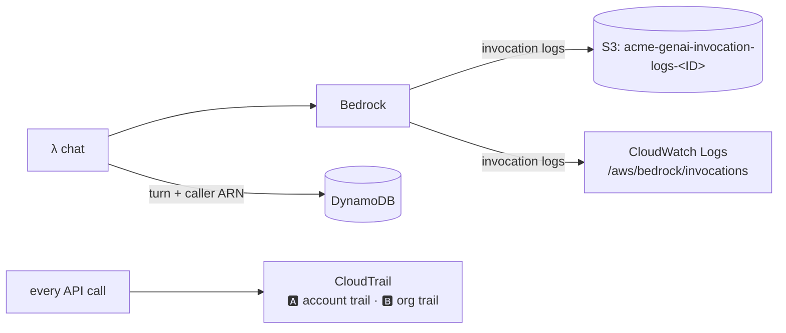

# Phase 6 — Audit: Who Asked What, and What Did It Say?

> **Mission:** keep a tamper-resistant record of every prompt, answer, model and caller, so security can investigate misuse and HR can prove what the assistant told people. (Control **G6**)

[⬅ Phase 5](05-api-lambda.md) · [Lab overview](../README.md) · [Phase 7 ➡](07-validation.md)

> [!NOTE]
> 🔨 **Being built.** Steps were written ahead of the build and are being checked in the console; 🔥 field notes record what differed.

---

## Why this matters

"The AI said I get 6 months of leave" is a real HR dispute waiting to happen. You need the **exact** prompt and response, **which** model and guardrail version, and **who** asked. Three sources together give that:

| Source | Answers | Contains prompts? |
|---|---|---|
| **Bedrock model invocation logging** | What went into and came out of the model | ✅ full text |
| **CloudTrail** | Who called which Bedrock / API Gateway / Lambda API, from where | ❌ metadata only |
| **App log (DynamoDB + Lambda logs)** | Caller ARN, session, question, answer, guardrail action | ✅ |



> [!NOTE]
> **Cost:** S3 storage ≈ $0. CloudWatch Logs ingestion is $0.50/GB; lab volume is a few KB. Set a short retention anyway.

---

## Steps

### 1 · Log bucket
`acme-genai-invocation-logs-<ACCOUNT_ID>`: BPA on, SSE-S3, versioning on, lifecycle expire after **30 days**. Bucket policy: [`policies/logging/invocation-log-bucket.json`](../policies/logging/invocation-log-bucket.json) (Bedrock may write, only for **this** account, scoped with `aws:SourceAccount` + `aws:SourceArn`).

### 2 · Log group (create it first)
**Bedrock does not create the CloudWatch log group for you.** If it doesn't exist, saving the logging settings fails with *"The specified log group does not exist."* Create it in **us-east-1** (check the region selector) with the exact name, **no trailing `/`**:

```bash
aws logs create-log-group --region us-east-1 --log-group-name /aws/bedrock/invocations
aws logs put-retention-policy --region us-east-1 --log-group-name /aws/bedrock/invocations --retention-in-days 14
aws logs describe-log-groups --region us-east-1 --log-group-name-prefix /aws/bedrock --query 'logGroups[].logGroupName'
# ["/aws/bedrock/invocations"]
```

Or in the console: CloudWatch → **Logs → Log groups → Create log group** → name `/aws/bedrock/invocations`, retention **14 days**.

### 3 · Model invocation logging
Bedrock → **Settings** → **Model invocation logging** → on:

| Field | Value |
|---|---|
| Data types | ✅ **Text** only (Image, Embeddings, Video off) |
| Logging destinations | **Both S3 and CloudWatch Logs** |
| S3 location | *Browse S3* → `acme-genai-invocation-logs-<ACCOUNT_ID>` |
| Log group name | `/aws/bedrock/invocations` |
| Choose a method to authorize Bedrock | **Create default role** → **type a Role name**: `acme-genai-bedrock-logging-role` (the box starts empty; *"A new role will be created named """* means you haven't typed one yet) |
| S3 location for large data delivery – optional | Leave **empty**. Only for payloads > 100 KB or binary (images); chat text is a few KB |

*Save settings*. If you get *"Failed to validate permissions for log group … with role …"*, wait 30 seconds and save again: a brand-new IAM role takes a moment to become usable.

It's an account + region setting: it logs **every** model call in `us-east-1`, not just this app.

> **Why S3 needs a bucket policy but CloudWatch needs a role:** S3 lets the bucket itself say "Bedrock may write here" (a **resource policy**: step 1). CloudWatch log groups can't grant that to Bedrock, so Bedrock **assumes a role** that has `logs:CreateLogStream` and `logs:PutLogEvents` (an **identity policy**). Same goal, the two halves of IAM.

### 4 · Lambda log retention
Set retention to **14 days** on `/aws/lambda/acme-genai-chat` too (CloudWatch → Log groups → select → *Actions → Edit retention setting*).

### 5 · CloudTrail
- **🅰️** Create a trail (single account, all regions) to an S3 bucket, log file validation **on**.
- **🅱️** Nothing to do: Lab 1's **org trail** already covers `genai-dev`. Optional stretch: also send invocation logs to the `security` account.

### 6 · A small dashboard
CloudWatch → Dashboards → `acme-genai`: Lambda invocations/errors/duration, API Gateway 4XX/5XX, Bedrock `Invocations` and `InputTokenCount`/`OutputTokenCount` for Nova Micro, and guardrail interventions (Logs Insights on the Lambda log: `guardrailAction = "INTERVENED"`).

## Verify

```bash
aws bedrock get-model-invocation-logging-configuration
aws logs tail /aws/bedrock/invocations --since 1h        # after one /chat call
aws dynamodb scan --table-name acme-genai-chat-history --max-items 3
aws cloudtrail lookup-events --lookup-attributes AttributeKey=EventSource,AttributeValue=bedrock.amazonaws.com --max-results 5
```

To check during the build:
- Do **Knowledge Base** model calls (`RetrieveAndGenerate`) show up in invocation logs?
- Which Bedrock runtime calls does CloudTrail record as **management** vs **data** events? Data events are off by default and cost extra.

---

## ⚠️ Known gotchas

- **Invocation logs contain everything users type**, including personal data. Treat the bucket like HR data: tight access, short retention, encryption.
- **Missing bucket policy = silent failure.** If Bedrock can't write, the console may still show logging as on. Check the log group/bucket after the first call.

## 🔥 Field notes

Saving model invocation logging took four tries. Each error, in the order hit:

| Error | Real cause | Fix |
|---|---|---|
| `bedrock.settings.dataLogs.validationErrors.required` | A console bug shows the message key instead of *"this field is required"*. Most likely the **role name** box under *Create default role*, which starts empty | Type a role name |
| `The specified log group does not exist.` | The log group had been created in **another region**; `describe-log-groups` in us-east-1 returned `[]` | Create it in us-east-1 (step 2) and reload the Bedrock page |
| `Failed to validate permissions for log group: /aws/bedrock/invocations/, with role: …Bedrock-role-…` | Typed the name with a **trailing `/`**, so the auto-created role was scoped to a log group that doesn't exist | Use `/aws/bedrock/invocations` exactly, create a **new** default role, delete the wrong role in IAM |
| Same, with the right name | New IAM role not yet usable | Wait 30 s, save again |

Lesson: IAM resource ARNs must match **exactly**. One extra character and the policy covers a different (non-existent) resource.

---

## 🎤 Interview corner

<details><summary>What's the difference between CloudTrail and Bedrock invocation logs?</summary>

CloudTrail records **API activity**: who called `InvokeModel`, when, from which IP/endpoint, with which model ID. It doesn't store the prompt or response. Invocation logging stores the **content**: request and response bodies, token counts. You usually need both: CloudTrail to find the event, invocation logs to see what was said.
</details>

<details><summary>Logging prompts captures personal data. How do you handle that?</summary>

Minimise and protect it: short retention, encryption (KMS for stricter setups), access limited to a small security role, guardrail PII masking so answers don't echo it, and a documented purpose (audit/abuse detection). Some teams log only metadata plus a hash and keep full text for a few days.
</details>

---

**Terraform:** planned in `terraform/audit/`.

[⬅ Phase 5](05-api-lambda.md) · [Lab overview](../README.md) · [Phase 7 ➡](07-validation.md)
